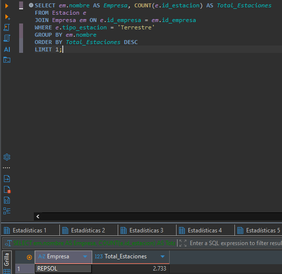
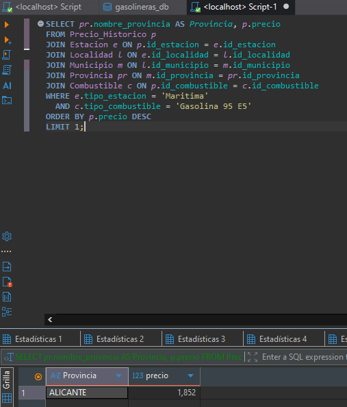

# Consultas SQL - Actividad 1

## 1. Nombre de la empresa con más estaciones de servicio terrestres
```sql
SELECT em.nombre AS Empresa, COUNT(e.id_estacion) AS Total_Estaciones
FROM Estacion e
JOIN Empresa em ON e.id_empresa = em.id_empresa
WHERE e.tipo_estacion = 'Terrestre'
GROUP BY em.nombre
ORDER BY Total_Estaciones DESC
LIMIT 1;
```


## 2. Nombre de la empresa con más estaciones de servicio marítimas
```sql
SELECT em.nombre AS Empresa, COUNT(e.id_estacion) AS Total_Estaciones
FROM Estacion e
JOIN Empresa em ON e.id_empresa = em.id_empresa
WHERE e.tipo_estacion = 'Maritima'
GROUP BY em.nombre
ORDER BY Total_Estaciones DESC
LIMIT 1;
```


## 3. Localización, nombre de empresa y margen de la estación con el precio más bajo para el combustible «Gasolina 95 E5» en la Comunidad de Madrid
```sql
SELECT 
    l.nombre_localidad AS Localizacion, 
    em.nombre AS Empresa, 
    e.margen AS Margen, 
    p.precio
FROM Precio_Historico p
JOIN Estacion e ON p.id_estacion = e.id_estacion
JOIN Empresa em ON e.id_empresa = em.id_empresa
JOIN Localidad l ON e.id_localidad = l.id_localidad
JOIN Municipio m ON l.id_municipio = m.id_municipio
JOIN Provincia pr ON m.id_provincia = pr.id_provincia
JOIN Combustible c ON p.id_combustible = c.id_combustible
WHERE pr.nombre_provincia = 'MADRID' 
  AND c.tipo_combustible = 'Gasolina 95 E5'
ORDER BY p.precio ASC
LIMIT 1;
```


## 4. Localización, nombre de empresa y margen de la estación con el precio más bajo para el combustible «Gasóleo A» si resido en el centro de Albacete y no quiero desplazarme más de 10 km
```sql
SELECT 
    l.nombre_localidad AS Localizacion, 
    em.nombre AS Empresa, 
    e.margen AS Margen, 
    p.precio,
    (6371 * ACOS(COS(RADIANS(38.994349)) * COS(RADIANS(e.latitud)) * COS(RADIANS(e.longitud) - RADIANS(-1.858542)) + SIN(RADIANS(38.994349)) * SIN(RADIANS(e.latitud)))) AS distancia_km
FROM Precio_Historico p
JOIN Estacion e ON p.id_estacion = e.id_estacion
JOIN Empresa em ON e.id_empresa = em.id_empresa
JOIN Localidad l ON e.id_localidad = l.id_localidad
JOIN Combustible c ON p.id_combustible = c.id_combustible
WHERE c.tipo_combustible = 'Gasóleo A' 
  AND e.latitud != 0 
HAVING distancia_km <= 10
ORDER BY p.precio ASC
LIMIT 1;
```


## 5. Provincia en la que se encuentre la estación de servicio marítima con el combustible «Gasolina 95 E5» más caro
```sql
SELECT pr.nombre_provincia AS Provincia, p.precio
FROM Precio_Historico p
JOIN Estacion e ON p.id_estacion = e.id_estacion
JOIN Localidad l ON e.id_localidad = l.id_localidad
JOIN Municipio m ON l.id_municipio = m.id_municipio
JOIN Provincia pr ON m.id_provincia = pr.id_provincia
JOIN Combustible c ON p.id_combustible = c.id_combustible
WHERE e.tipo_estacion = 'Maritima' 
  AND c.tipo_combustible = 'Gasolina 95 E5'
ORDER BY p.precio DESC
LIMIT 1;
```
